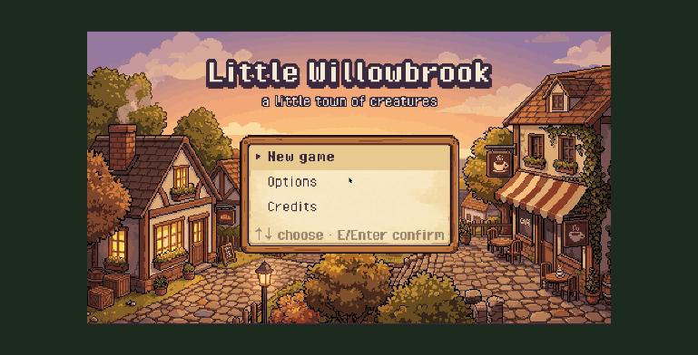
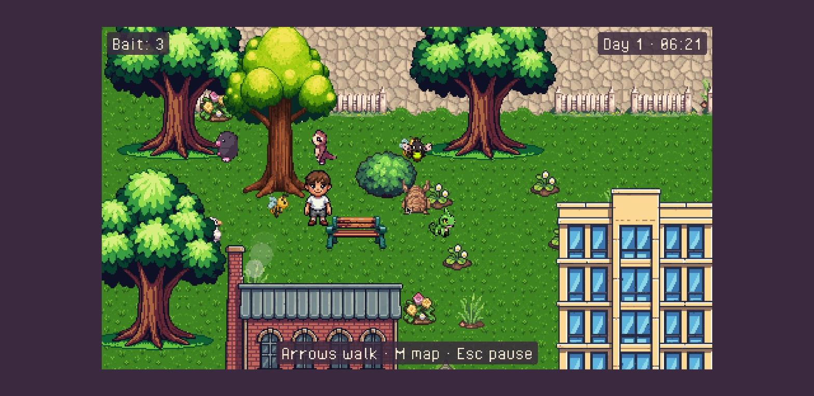
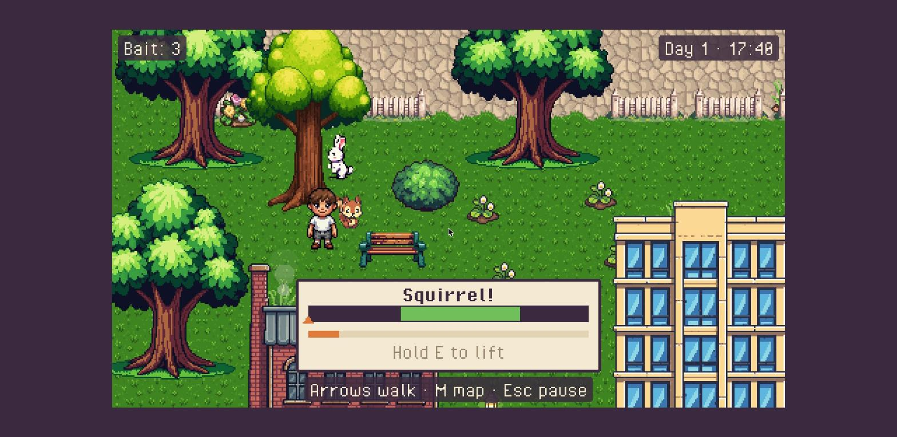
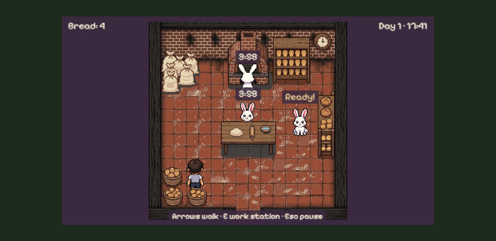
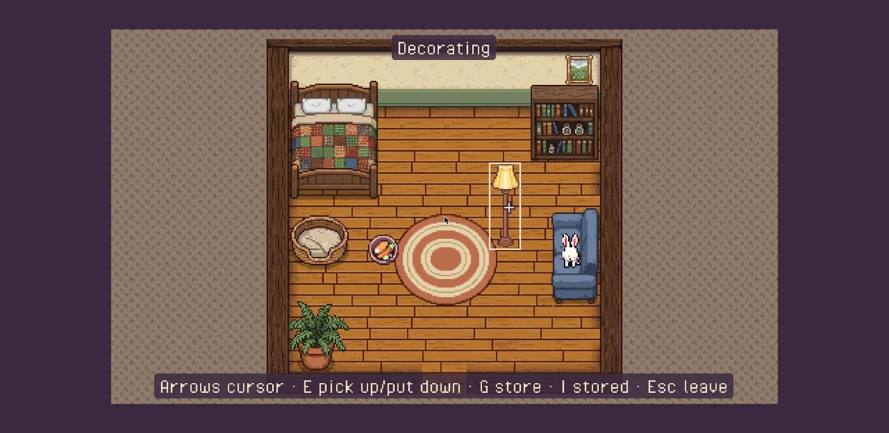
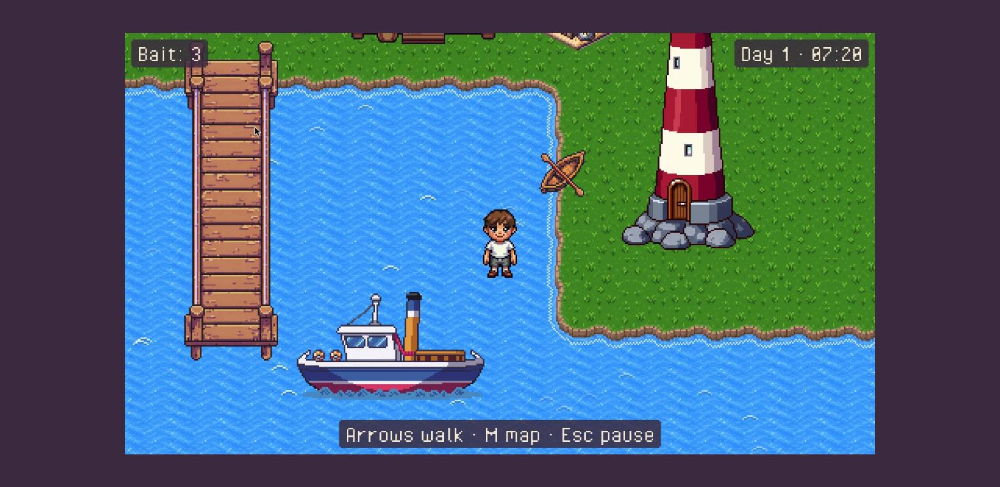
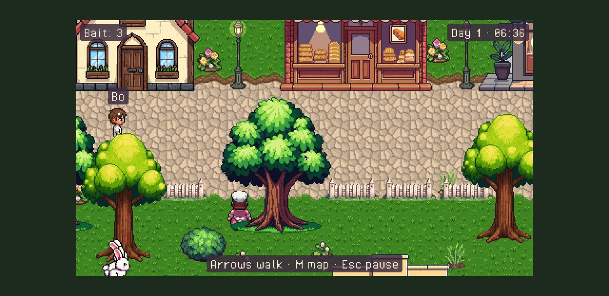
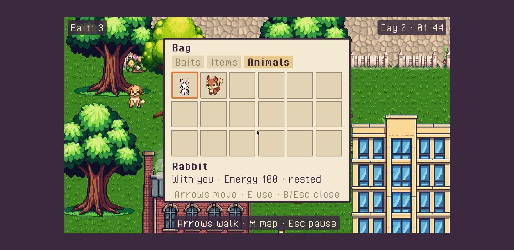

<p align="center">
  
</p>

<h1 align="center">Little Willowbrook</h1>

<p align="center">
  <em>A cozy, social pixel-art game about catching creatures and putting them to work in a little town.</em>
</p>

---

Wander the streets of Little Willowbrook, lure wild creatures with the right
bait, and send them off to bake bread, sew fabric or build things on
real-time shifts that keep running while you're away. Sell what they make,
decorate your apartment, and see other players doing the same in a shared
online town.

> **Status:** early prototype, actively in development and playable locally.

## Screenshots

<table>
  <tr>
    <td></td>
    <td></td>
  </tr>
  <tr>
    <td align="center"><sub>Creatures roam the park at different times of day</sub></td>
    <td align="center"><sub>Catch them with bait and a tension minigame</sub></td>
  </tr>
  <tr>
    <td></td>
    <td></td>
  </tr>
  <tr>
    <td align="center"><sub>Put them to work on real-time shifts</sub></td>
    <td align="center"><sub>Decorate your own apartment</sub></td>
  </tr>
  <tr>
    <td></td>
    <td></td>
  </tr>
  <tr>
    <td align="center"><sub>Take the ferry from the harbour to the shore</sub></td>
    <td align="center"><sub>Meet other players in a shared town</sub></td>
  </tr>
</table>

<p align="center">
  <br>
  <sub>Carry baits, items and creatures in your bag</sub>
</p>

## Features

**Your character and home**
- Character creator with layered body, hair, clothes and colours.
- Your own apartment to decorate: move, store and buy furniture.
- A pet with its own life. It naps, eats, asks to be petted and can follow you outside.

**The town**
- A walkable town with ten buildings, a park, a harbour and a ferry to the shore.
- Townsfolk with daily routines, pigeon flocks, fountains, street lamps and chimney smoke.
- A day and night clock: one in-game day lasts 24 real minutes.

**Creatures**
- 28 species with their own rarity, habitats, favourite bait and job strengths.
  19 of them already roam the world.
- Wary creatures that flee if you rush them, and a tension minigame to land rarer catches.
- Creatures that climb trees, follow you around and tire out after work.

**Work and economy**
- Nine building interiors with work stations. Shifts run on timestamps and
  keep going while the game is closed.
- Each species is better or worse at each job. A bee bakes fast; a beaver builds well.
- Sell bread, planks, fabric, coffee beans and more at the market, then buy bait and furniture.

**Online**
- Log in with a name; your save lives on the game server.
- See other players walking around in real time and visit their apartments.

**Also**
- English and Brazilian Portuguese.
- Touch controls for phones and tablets.

## Controls

| Key | Action |
|---|---|
| Arrow keys | Walk |
| `E` / `Enter` | Interact, confirm |
| `B` | Bag |
| `M` | Town map |
| `Esc` | Pause menu, back |

## Running it locally

Requires [Node.js](https://nodejs.org/) with npm.

```bash
npm install
npm run dev
```

This starts the game and its server together at `http://localhost:5173`.

Other commands: `npm test` runs the test suite, and `npm run build` builds the client.

## Built with

[Phaser 3](https://phaser.io/) · TypeScript · [Vite](https://vite.dev/) ·
[Colyseus](https://colyseus.io/) · SQLite · [Vitest](https://vitest.dev/).
Art made with [PixelLab](https://pixellab.ai/). Font:
[Pixel Operator](https://fontlibrary.org/en/font/pixel-operator) by Jayvee Enaguas (CC0).

## License

© 2026 Samuel Salles. All rights reserved. See [LICENSE](LICENSE).
